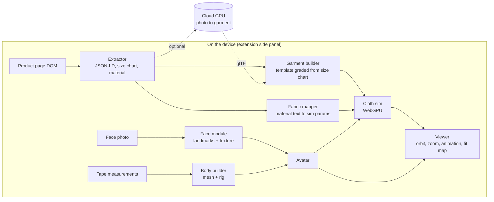

# Avatar Try-On: feasibility and architecture

## Answer

The tool is feasible as a Chrome extension that does all its work on the device. Build it in this order: avatar, then fit map, then moving cloth. The avatar part is built and tested in [[avatar-poc/README|avatar-poc]]. A virtual tape on the mesh gives back the typed measurements within 0.5 cm. On 3,038 held-out people from the US Army ANSUR II survey, the avatar's volume predicts their scale weight with 2.5% mean error, with nothing fitted.

One part is not solved by anyone today: turning any product photo from any shop into a 3D garment that drapes correctly. The PoC therefore uses garment templates (a t-shirt, trousers, a dress) that are graded from the shop's size chart. A cloud GPU service can add photo-to-garment later, when the research is good enough.

## What the user asked for, and how feasible each part is

| Feature | Feasible now? | How | Difficulty |
|---|---|---|---|
| Avatar from typed measurements, true proportions | Yes. Built. | Parametric body: each cross-section is scaled so its perimeter equals the tape measurement | Low for a mannequin. Medium for a realistic body (fit the Anny model to the measurements) |
| Rotate, pan, zoom, preset views | Yes. Built. | Three.js `OrbitControls` | Low |
| Skin colour | Yes. Built. | Material colour, presets, or a sample from the face photo | Low |
| Face from one photo | Partly. A flat projection is built. A real 3D face is medium work. | Now: photo projected onto the front of the head. Next: MediaPipe Face Landmarker (Apache-2.0, runs in the browser) warps the head mesh to 478 landmarks, then the photo is projected as a texture | Medium |
| Animations | Yes. Built (walk, idle, turn, arms up). | Skeleton with 17 bones and procedural motion. Next: Mixamo clips retargeted to the rig | Low (procedural). Medium (retargeted clips) |
| Clothes that move with the body | Yes for template garments | GarmentCode templates (MIT) sized from the size chart. JoltPhysics.js (MIT, WASM) soft body with skin constraints: each cloth vertex follows the animated body and can drift from it by a set distance. Bone capsules for loose parts such as a skirt hem | Medium. About 2 to 4 weeks |
| Cloth behaviour from material specs | Partly | Lookup table: fabric type sets base stretch, shear and bend. Weight in gsm sets mass (denim oz/yd² × 33.9 = g/m²). Elastane lowers stretch stiffness in the knit direction | Medium for "visibly different by fabric". Research-level for "accurate to the specs" |
| Any garment from any website | No, not reliably | Size chart and material text: yes, from the page HTML. The 3D shape from a photo: research only | High |

## Architecture

Six modules, each with one job:

1. Body builder. Input: height, shoulder width, chest, waist, hip, and optional girths. Output: a skinned mesh with a skeleton. The PoC uses its own parametric mannequin. The production version fits Anny, an Apache-2.0 body model from NAVER LABS with 13,718 vertices and a 104-bone rig, to the same measurements. A gradient-descent fit on Anny's shape parameters can do this, because the model is differentiable.
2. Face module. Input: one front photo. Output: a head texture and small changes to the head shape. Runs MediaPipe in the browser, so the photo stays on the device.
3. Extractor. A content script reads the product page: schema.org `Product` JSON-LD, the size chart table, and the material text. An LLM fallback handles size charts in unusual formats.
4. Garment builder. Picks a GarmentCode template (t-shirt, skirt, dress, trousers) for the garment type and fills its parameters from the size chart and the avatar's measurements. ChatGarment (Apache-2.0) can choose the template from the product photo. The first drape runs offline and exports a mesh of 3,000 to 6,000 vertices as glTF.
5. Fabric mapper. Turns "95% cotton, 5% elastane, 180 gsm jersey" into stretch, bend, shear, density and friction values, from a table of reference fabrics. Ju et al. (Eurographics 2024) estimate stretch from exactly this tag data. Bending needs a physical drape test, so from text it stays a guess.
6. Viewer and cloth sim. Three.js scene. JoltPhysics.js runs the cloth with skin constraints, so cloth stays on the body through animation without mesh-on-mesh collision, which is too slow in a browser. A fit map colours the body where the garment is tight or loose.

## Three ways to deliver it

### A. Chrome extension, all on the device (recommended)

The content script reads the product page. The side panel hosts the viewer and the cloth simulation (JoltPhysics.js in WASM, WebGPU later). The service worker holds the models. Measurements and the face photo stay in the browser.

- Strengths: it reads the page's HTML, so it gets the size chart and material text, including content hidden in pop-ups. There is no server cost and no upload of body data. It works on any shop.
- Weaknesses: garments are templates, so a garment's style details (collar shape, pockets) are approximate. The cloth simulation is limited by the user's GPU.
- Blockers: no garment 3D shape from a photo, and size charts in many formats. The Chrome Web Store asks for a privacy policy and consent for sensitive data. Body data probably counts.
- Difficulty: medium. About 6 to 8 weeks for one person to reach a usable PoC with three garment templates.

### B. Extension or web app plus a cloud GPU backend

The extension reads the page and shows the result. A GPU server turns the product photo into a 3D garment with a sewing pattern (research such as Dress-1-to-3 and DressWild in 2025 and 2026), runs a high-quality cloth simulation, and returns a glTF file.

- Strengths: the only path to the real garment shape, not a template.
- Weaknesses: GPU cost for each try-on, wait times of tens of seconds, and body data on a server. The research methods are not reliable on arbitrary shop photos.
- Blockers: privacy law (body shape and face are sensitive data), the cost model, and research quality.
- Difficulty: high. About 3 to 4 months to a PoC that works on more than hand-picked photos.

### C. Standalone desktop app that reads the screen

The app captures the screen (ScreenCaptureKit on macOS, Graphics Capture on Windows) and finds garments with a vision model.

- Strengths: works in any app, not only a browser.
- Weaknesses: it sees only pixels, so it misses size charts in closed pop-ups and the page's structured data. macOS asks the user again for Screen Recording permission about once a month. Windows shows a yellow border while it captures. A native build is needed for each operating system.
- Blockers: no benchmark for reading size charts from screenshots, the permission friction, and fragile parsing.
- Difficulty: high, for less value than A.

### Why A first

The hard problem (photo to 3D garment) is unsolved in all three. A gets the best data (the page HTML) at the lowest cost, and it keeps body data private. B's cloud service can plug into A later through one interface: the garment builder accepts a glTF garment from any source.

## Blockers, ranked

1. Garment shape from a photo. No general solution. Brands keep their CLO and Browzwear 3D assets private. Dress-1-to-3 and DressWild publish papers but no usable code. Use GarmentCode templates now.
2. Fabric data. Of 3.3 million web hosts with schema.org Product markup, 0.29% fill in `material` and 0.10% fill in `size` (Web Data Commons, October 2024). Schema.org has no property for fabric weight or stretch. Expect to parse free text with an LLM. Composition and weight give an estimate only, so a "fits" verdict on stretch fabric has a wide error.
3. Cloth performance. A WebGPU study ran 10,000 cloth nodes at 30 fps against a 25,000-vertex static mesh on a desktop GPU, and tested no animated bodies. Skin constraints and bone capsules avoid this cost.
4. Size charts. Many formats: body measurements or garment measurements, tables or images, in pop-ups. Needs a parser per format and an LLM fallback.
5. Realistic body. The PoC mannequin is accurate at the measured landmarks only. A realistic look needs Anny fitted to the measurements. Installing Anny needs PyTorch, which this session could not install (the permission check blocked the package install).
6. Licences. SMPL, SMPL-X and STAR are for research only. A commercial licence for SMPL now comes from Max Planck Innovation after Epic Games bought Meshcapade. FLAME-based face methods (DECA, EMOCA, MICA) are research only. Use Anny and MediaPipe, which are Apache-2.0.
7. Privacy. Measurements and a face photo are sensitive. On-device processing avoids most of the risk. The Australian Privacy Act, GDPR and Illinois BIPA apply if data leaves the device.
8. Joint quality. Linear blend skinning pinches at the shoulders and hips in big poses. Anny's rig and corrective shapes reduce this.

## Competitors (October 2026)

Zalando has a measurement-based 3D avatar with a 360-degree view, as a pilot on its own catalogue. Google's try-on in Search makes a 2D generated image from a selfie, for its own catalogue. It closed its standalone Doppl app in April 2026 (one source). Style.me and Bods sell avatar fitting rooms to single retailers. Chrome extensions such as Fitly and Vesti AI make 2D generated images from one photo, with no 3D and no cloth motion. No product found does all three: works across shops, uses a measured 3D body, and simulates moving cloth.

## PoC results

Built in [[avatar-poc/README|avatar-poc]]:

- Mesh from five required measurements (height, shoulder width, chest, waist, hip) and six optional ones. 6,831 vertices, 17 bones.
- 14 of 14 tests pass. The virtual tape matches each input within 0.5 cm on four profiles: average man, average woman, tall slim, short broad. The tape is independent code: it cuts the triangles with a plane and wraps a convex hull around the cut.
- Checked in the browser: orbit, zoom, the six camera views, walk, idle, turn, arms up, skin presets, the face photo projection, the skin match from the photo, and the "Real people" buttons. No console errors.

## Validation against 6,068 real people (ANSUR II)

ANSUR II is the 2012 US Army body survey. Each of its 6,068 adults has tape and caliper measurements and a scale weight. For each person, the script builds an avatar from the same inputs a user types, measures it with the virtual tape, and turns its volume into a weight. Weight is never an input, so it is a fair outside judge of the parts nobody measured: limbs, head, and the shape between the landmarks. One density value is fitted on half of the people. All scores below are on the other half (3,038 people).

| Model | Mean error | Within 5% | Within 10% |
|---|---|---|---|
| Avatar volume × 1.00 kg/L, nothing fitted | 2.5% (bias −0.4 kg) | 88% | 100% |
| Avatar volume × 1.008 kg/L, fitted | 2.6% | 88% | 100% |
| Baseline: median BMI × height² | 11.6% | 28% | 51% |
| Baseline: linear regression on the same 5 inputs plus sex | 3.1% | 80% | 98% |

Men alone: 2.5% mean error. Women alone: 2.7%. The tape matched every input for all 6,068 people, and the input check rejected none of them.

What the real data changed:

1. The input check rejected 1,355 real people (22%). Its thigh and inseam limits were guesses. They now come from the ANSUR extremes.
2. The default ratios for optional measurements were guesses. They are now ANSUR medians. For example, thigh is 0.61 of the hip, not 0.58.
3. The first avatar overstated weight by 9.2% (+6.9 kg), and women by 15%. Two causes were found:
   - The torso cross-sections were too wide and round. ANSUR breadth and depth at the chest, waist and hip now set each ring's shape. The girth stays exact.
   - The volume counted overlapping parts twice, for example the thigh tops inside the torso. The volume is now the union of all parts.

   Together, these fixes take the error from 9.2% to 2.5%.

What is still wrong:

- Lean people (BMI under 22) come out 2.6 kg heavy, and BMI 30 and over come out 2.3 kg light. The shape between the landmarks does not follow body fat. For example, a belly that sticks out below the waist line is missed.
- No convex shape matches ANSUR's chest girth, breadth and depth together. The tape spans the back and the lats, which the breadth caliper does not measure. The chest is capped at a rounded-box shape, so it is a little wider than the ANSUR breadth.
- ANSUR II people are soldiers. Results on the general population can be worse.
- Weight is one number. A correct volume does not prove that each part has the right shape. A per-region check needs 3D scans, for example CAESAR (licensed) or the BodyM silhouettes.

## Next steps

1. Size-chart fit map: parse the size chart on 3 to 5 real shops. Colour the avatar where the garment is tight or loose. Test it on 10 garments Tim owns.
2. One moving garment: a t-shirt template, graded from a size chart, simulated with JoltPhysics.js skin constraints and fabric values from the material text.
3. Swap the mannequin for Anny fitted to the measurements, with the same tape tests.
4. Package as an MV3 extension with a side panel.

## Sources

- Anny body model, Apache-2.0: https://github.com/naver/anny, https://arxiv.org/abs/2511.03589
- SMPL-X licence: https://smpl-x.is.tue.mpg.de/modellicense.html. Meshcapade licence tiers: https://meshcapade.notion.site/The-SMPL-Model-Licenses-2144560e54388085af5eff111fcdf266. Max Planck on SMPL licensing after the Epic purchase: https://www.mpg.de/26082348
- MediaPipe Face Landmarker: https://developers.google.com/edge/mediapipe/solutions/vision/face_landmarker
- FLAME licence: https://flame.is.tue.mpg.de/modellicense.html
- Dress-1-to-3: https://arxiv.org/abs/2502.03449. DressWild: https://arxiv.org/abs/2602.16502. Image2Garment: https://arxiv.org/pdf/2601.09658
- Size in diffusion try-on: https://arxiv.org/pdf/2504.00562. FIT / Fit-VTO: https://fashn.ai/blog/google-research-and-uws-fit-what-it-means-for-virtual-try-on
- BodyM dataset (measurements from silhouettes): https://arxiv.org/abs/2210.05667
- 3DLOOK accuracy claim (vendor, 1.5 to 2.2 cm): https://3dlook.ai/?p=44386
- Chrome extensions: CSP https://developer.chrome.com/docs/extensions/reference/manifest/content-security-policy, network requests https://developer.chrome.com/docs/extensions/develop/concepts/network-requests, Web Store policy https://developer.chrome.com/docs/webstore/program-policies/policies, model size thread https://groups.google.com/a/chromium.org/g/chromium-extensions/c/-4CNcu5bUGA/m/SxP0RfNaCAAJ
- macOS Screen Recording prompt: https://9to5mac.com/2024/08/14/macos-sequoia-screen-recording-prompt-monthly/. Windows capture border: https://learn.microsoft.com/en-us/uwp/api/windows.graphics.capture.graphicscapturesession.isborderrequired
- Zalando avatar: https://corporate.zalando.com/en/technology/zalando-enhances-its-virtual-fitting-room-enabling-customers-create-3d-avatar-their-body
- Mixamo licence: https://helpx.adobe.com/creative-cloud/faq/mixamo-faq.html
- Ready Player Me shutdown: https://genies.com/blog/ready-player-me-shutdown
- Cloth: GarmentCode https://github.com/maria-korosteleva/GarmentCode, ChatGarment https://github.com/biansy000/ChatGarment, JoltPhysics.js skin constraints https://raw.githubusercontent.com/jrouwe/JoltPhysics.js/main/JoltJS.idl and https://github.com/jrouwe/JoltPhysics/discussions/804, ten-minute physics https://matthias-research.github.io/pages/tenMinutePhysics/, Rapier soft bodies https://dimforge.com/blog/2026/09/25/advanced-soft-bodies-for-games-in-the-rapier-physics-engine/
- Fabric parameters from tag data (Ju et al. 2024): https://cg.catholic.ac.kr/~mgchoi/publications/Fabric5k/. CLO Fabric Kit: https://support.clo3d.com/hc/en-us/articles/360041074334-Fabric-Kit-Manual
- Schema.org Product field use (Web Data Commons, October 2024): https://data.dws.informatik.uni-mannheim.de/structureddata/2024-12/quads/classspecific/Product/Product_domain_stats.csv
- WebGPU cloth performance: https://arxiv.org/abs/2507.11794
- ANSUR II survey: https://www.openlab.psu.edu/ansur2/ (data used from the mirror https://calmcode.io/datasets/ergonomics)
