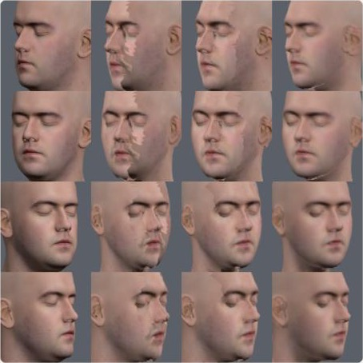

# Sweep spike: many face photos from one head turn

The question: in the one-sweep scan (mockup 4B), the user turns their head slowly left and then right. Can the scan keep many photos from that one turn, not only three posed photos? And do more photos make the face twin look more like the person?

The answer is yes, with one condition. One 11-second turn gives 11 usable photos, one every 10 degrees. But only a twin that blends the photos gains from more of them. With today's texturing, which takes each triangle from one photo, more photos still leave visible seams.



Columns, from the left: the real head, today's twin (3 photos), 11 photos, and 11 photos blended. The rows are four angles that no photo saw.

## How the test works

A test needs a face with a known answer. So the page uses a 3D head scan in place of a webcam: Lee Perry-Smith (CC BY 3.0), from the three.js examples.

1. The page renders the scan turning its head like a person: hold, turn left to 72 degrees, turn right to 72 degrees, and back, with a small nod and tilt. It renders 30 frames a second. Each frame is the average of 4 renders while the shutter is open, so a fast turn blurs like a webcam image.
2. Each frame goes through the MediaPipe face landmarker in video mode, as in the extension's capture page. `sweep.js` keeps the sharpest frame near the centre of each 10-degree bin of head turn. Sharpness is the variance of the Laplacian on the face. The same frames also go through today's hold-still capture (`extension/capture-core.js`) for comparison.
3. The twin is built three times with the existing code (`twin-spike/analyse.js` and `head.js`): from 3 photos (0 and ±50 degrees, as today), from 5 photos (0, ±30, ±50) and from all 11 photos. Each twin is textured two ways:
   - Switch (today): each triangle takes the photo that sees it most directly.
   - Blend (new, in this spike only): a shader mixes every photo by how directly the photo sees the spot (the cosine to the 4th power), where the segmenter marks skin.
4. The page renders the real head and each twin at test angles. A test angle is at least 4 degrees of true head turn away from every photo taken. The twin render is aligned to the real render by the 468 face points. The page then measures three scores. The colour error is the mean difference inside the face outline, from 0 to 255, and lower is better. The page also gives the PSNR and the face point error in mm after alignment.

## Run it

1. Start a static server in the repository root, because the page imports `../twin-spike/` and `../extension/`.

   ```bash
   python3 -m http.server 8790 --bind 127.0.0.1
   ```

2. Open http://localhost:8790/sweep-spike/ in Chrome. The run takes about 20 seconds. The first run downloads the MediaPipe models, the scan and the MakeHuman head.

The frame picker has unit tests:

```bash
node --test sweep-spike/
```

## Results

One run in the Claude desktop app's browser (Chromium), 2026-10-28.

The sweep:

- 331 frames, with a face found in 293. The landmarker takes 15 ms a frame, so the selection runs live at 30 frames a second.
- All 11 bins had a photo after 7.3 seconds, which is one turn left and one turn right.
- Today's hold-still capture took only 2 of its 3 photos from the same video. It needs the head to hold within 6 degrees for 0.4 seconds, and a sweep does not stop.

The twin, at 17 test angles from -60 to +60 degrees:

| Twin | Colour error | PSNR (dB) | Face point error (mm) | Angles where no face was found on the twin |
|---|---|---|---|---|
| 3 photos, switch (today) | 15.4 | 22.1 | 2.5 | 4 |
| 3 photos, blend | 12.5 | 23.7 | 2.6 | 1 |
| 5 photos, switch | 13.0 | 23.4 | 2.4 | 2 |
| 5 photos, blend | 10.7 | 24.9 | 2.5 | 1 |
| 11 photos, switch | 12.8 | 23.2 | 2.5 | 2 |
| 11 photos, blend | 10.5 | 24.9 | 2.6 | 1 |

In every twin, the test angle -60 degrees found no face on the real render either. The other misses are seams that confuse the landmarker.

## What we learned

1. A sweep can collect many photos. The bins fill in one turn, and the landmarker is fast enough to choose frames live.
2. Blending matters more than the number of photos. Blending alone cuts the colour error by 19% (15.4 to 12.5). Blending 5 photos cuts it by 31% (to 10.7). Going from 5 to 11 photos adds almost nothing on this head.
3. More photos do not change the face shape. The face point error stays at 2.4 to 2.6 mm in every case. The shape comes from MediaPipe and the MakeHuman warp, and both already see enough in 3 photos.
4. The pose matrix reads large turns low, and differently on each side. The -50 bin was filled at a true turn of 72 degrees, and the +50 bin at a true -66 degrees. Bins past ±50 degrees never fill, so `sweep.js` stops at ±50. The README of `twin-spike` already notes that the left turn reads low.
5. The scan screen cannot reuse today's capture logic. A sweep needs the bin picker in `sweep.js`, not the hold-still state machine. `sweep.progress()` and the filled bins map directly onto the ring of ticks in mockup 4B.

## Recommendation

Build the one-sweep scan with `sweep.js` and keep at least 5 photos (0, ±30 and ±50 degrees). Eleven JPEG photos are about 0.7 MB in `chrome.storage.local`, so the extension can keep all 11. Move the blend shader into `twin-spike/head.js` so that the extension panel uses it too.

## Limits

- The test uses one rendered head with no hair. The scan has its eyes closed. A real webcam adds noise, auto exposure that changes between frames, and real motion blur. Test with real people before you trust the numbers.
- The room light is fixed while the head turns, so the photos have different shading, as in real life. The test angles use the same light.
- The blend has no occlusion test. At large turns, the nose can bleed colour onto the far cheek. The cosine weight limits this, but does not stop it.
- The blend shader takes at most 16 photos.
- The twin is rendered with an orthographic camera and the real head with a 14-degree perspective camera. The face point alignment absorbs most of the difference, but not all of it.
- `buildTwin` in `twin-spike/head.js` now takes any number of photos. Before, it took exactly three. The 3-photo result does not change, and the twin-spike tests pass.

## Files

| File | What it does |
|---|---|
| `sweep.js` | Picks photos from a head turn: bins, sharpness, pitch and face size checks. No browser APIs. |
| `sweep.test.mjs` | Tests the bins, the frame choice and the sharpness measure. |
| `index.html`, `main.js` | The test page: renders the sweep, builds the twins and scores them. |
| `sheet.jpg` | The side-by-side image from the run above. |
